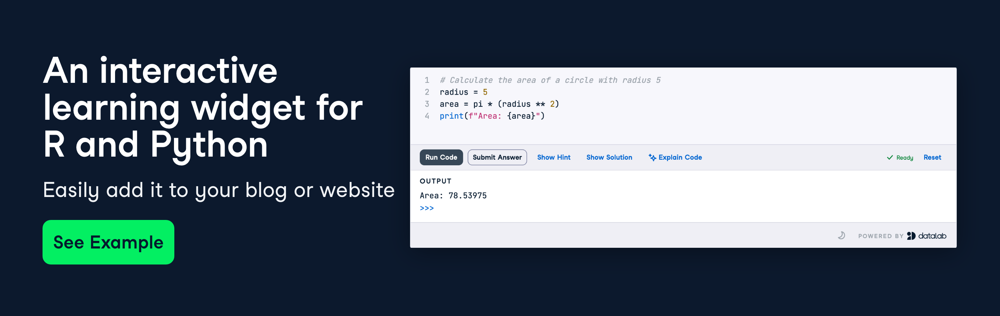

<h1 align="center">DataCamp Light</h1>
<p align="center">
  Convert any website or blog into an interactive learning platform for data science.
</p>



DataCamp Light is an embeddable widget that turns plain HTML code blocks into runnable,
checkable exercises: learners edit code in the page itself, the widget runs it, and the
submission is graded against the exercise's SCT. Python, R, shell and SQL are supported,
and the widget is styled with DataCamp's Waffles design system.

## How to use

Include the script bundle on your page — it registers its fonts and injects its styles
itself, so no separate `<link>` is required:

```html
<script
  type="text/javascript"
  src="https://cdn.datacamp.com/dcl/v4/prod/dcl-react.js"
></script>
```

`https://cdn.datacamp.com/dcl/v4/prod/` is the entry for the newest release. Every
release is also published under its own tag (`/dcl/v4/<tag>/`), so a published build is
immutable; embed the `prod/` path, never a tag path.

The library auto-boots every `[data-datacamp-exercise]` element once the DOM is ready.
Existing embeds that load the legacy `https://cdn.datacamp.com/dcl-react.js.gz`
entrypoint continue to work unchanged.

If your app adds exercises dynamically after the initial page load (for example, in a
single-page application), call:

```js
initAddedDCLightExercises();
```

### Public API

The bundle installs these globals when it evaluates:

- `initAddedDCLightExercises()` — scans `[data-datacamp-exercise]` and boots each element.
- `initDataCampLight` — alias of `initAddedDCLightExercises`.
- `window.dcl.init()` — same as both init entry points.
- `window.dcl.bootElement(element)` — boots one element (the path to use when you add an embed after page load).
- `window.dcl.getSettings(element)` — synchronously parses an element into `ExerciseSettings` (element attributes, code blocks, `data-settings`, `data-encoded`).
- `window.dcl.createWasmSession(language)` — creates a headless session for tooling and tests. It exposes `initialize(params)`, `runCode(params)`, `submitCode(params)` and `destroy()` (plus `runCommand(params)` for shell). Normal embeds never need it.

## Writing the HTML block

Place HTML blocks in the format below anywhere on your page:

<!-- prettier-ignore -->
```html
<div
  data-datacamp-exercise
  data-lang="python"
  data-packages=""
  data-height="auto"
>
  <code data-type="pre-exercise-code">
    # This will get executed each time the exercise gets initialized
    b = 6
  </code>
  <code data-type="sample-code">
    # Create a variable a, equal to 5
    # Print out a
  </code>
  <code data-type="solution">
    # Create a variable a, equal to 5
    a = 5
    # Print out a
    print(a)
  </code>
  <code data-type="sct">
    Ex().check_object("a").has_equal_value()
    Ex().success_msg("Great job!")
  </code>
  <div data-type="hint">
    Use the assignment operator (<code>=</code>) to create the variable
    <code>a</code>.
  </div>
</div>
```

### HTML Data Attributes

All configuration options are passed as data attributes on the root exercise element
(the attribute name is the camelCase setting in kebab-case, e.g. `showRunButton` →
`data-show-run-button`):

| Attribute                   | Type             | Default               | Description                                                                                                                                                                                                                                                                                                                            |
| :-------------------------- | :--------------- | :-------------------- | :--------------------------------------------------------------------------------------------------------------------------------------------------------------------------------------------------------------------------------------------------------------------------------------------------------------------------------------- |
| `data-datacamp-exercise`    | Flag             | —                     | Identifies the `<div>` as an interactive DataCamp Light exercise.                                                                                                                                                                                                                                                                      |
| `data-lang`                 | String           | `r`                   | Target language: `python`, `r`, `shell` or `sql`. Any other language (`txt`, `json`, `javascript`, …) enters **Editor-Only Mode**: an editable editor with no code execution.                                                                                                                                                            |
| `data-theme`                | String           | `undefined`           | Initial theme: `light` or `dark`. When omitted, the widget inherits the user's operating-system colour scheme (`prefers-color-scheme`).                                                                                                                                                                                                 |
| `data-shared-environment`   | String / Boolean | `undefined`           | Shares one runtime environment and one virtual filesystem with every other widget carrying the same value (`true` is itself a group name). Pre-exercise code, solution and SCT stay per exercise; SQL can share an environment with Python and shell.                                                                                    |
| `data-autocomplete`         | Boolean          | `true`                | Set to `false` to disable editor autocompletion.                                                                                                                                                                                                                                                                                       |
| `data-show-ai`              | Boolean          | `true`                | Set to `false` to disable the AI features ("Explain Code" and "Fix & Explain").                                                                                                                                                                                                                                                         |
| `data-packages`             | String           | `""`                  | Comma-separated packages to install at runtime: Python from PyPI (e.g. `pandas==1.5.3, numpy`), R from a CRAN repository (e.g. `dplyr`).                                                                                                                                                                                                |
| `data-height`               | Number / String  | `auto`                | Height mode. A number sets a fixed height in `px`. `auto` (or omitted) sizes the editor to the initial sample code (`240px` minimum) and the shell terminal to the whole widget (`300px` minimum). `grow` makes the editor (`python`, `r`, `sql`) follow its content while typing (minimum `240px`, capped at `800px` with internal scrolling); dragging the resize handle pins a fixed height and Reset unpins it. |
| `data-show-run-button`      | Boolean          | `false`               | Shows the "Run Code" button next to "Submit Answer" on a graded exercise. Run is always shown when the exercise has no SCT (there is no Submit to fall back on), so omitting this attribute never leaves the widget without an action.                                                                                                     |
| `data-no-lazy-load`         | Flag             | `false`               | When present, boots the exercise immediately instead of waiting for it to reach the viewport.                                                                                                                                                                                                                                           |
| `data-preview-drop-zone`    | Flag             | `false`               | Keeps the drag-and-drop overlay visible, so learners can see that files are accepted before they drag one.                                                                                                                                                                                                                              |
| `data-allow-solution-error` | Flag             | `false`               | Tolerates a solution that raises while grading instead of failing the submission.                                                                                                                                                                                                                                                       |
| `data-impact-tracking-link` | String           | `undefined`           | Affiliate tracking path appended to the "Powered by DataLab" link; an absolute URL is used as-is, otherwise it is prefixed with `https://datacamp.pxf.io`.                                                                                                                                                                              |
| `data-utm-source`           | String           | `datacamp_light`      | Custom UTM source parameter passed to the "Powered by DataLab" link.                                                                                                                                                                                                                                                                    |
| `data-utm-campaign`         | String           | `powered_by_datalab`  | Custom UTM campaign parameter passed to the "Powered by DataLab" link.                                                                                                                                                                                                                                                                   |
| `data-encoded`              | Flag             | `false`               | Legacy encoded form: the entire payload (settings + content) is a base64-encoded, URI-encoded JSON string inside the element text. Not crawlable — prefer `data-settings` for new content.                                                                                                                                              |
| `data-settings`             | String           | `undefined`           | SEO-friendly encoded form: the settings, SCT, setup code and hint are a base64-encoded, URI-encoded JSON string in the attribute, while the solution stays in a nested `<code data-type="solution">` block so crawlers can read it. Content keys in the JSON override the nested blocks.                                                 |

Both encoded forms are read through the same field table as the attributes, so a key in
the JSON behaves exactly like its `data-*` counterpart. Besides the camelCase names, the
content fields accept the snake_case spellings the CMS publishes
(`pre_exercise_code`, `sample` / `sample_code`).

### Pre-Exercise Code

Pre-exercise code executes in the background when the exercise environment initializes. Use it to preload datasets or setup variables:

<!-- prettier-ignore -->
```html
<code data-type="pre-exercise-code">
  # Preload variables or datasets
  pi = 3.14159
</code>
```

### Sample Code

Initial starter code rendered inside the editor:

<!-- prettier-ignore -->
```html
<code data-type="sample-code">
  # Calculate circle area with radius 5
  radius = 5
  area =
  print(area)
</code>
```

### Solution

Target solution code checked during evaluation or shown when the learner clicks "Show Solution":

<!-- prettier-ignore -->
```html
<code data-type="solution">
  radius = 5
  area = pi * (radius ** 2)
  print(area)
</code>
```

### Submission Correctness Test (SCT)

Evaluates the learner's submitted code against the solution:

- **Python**: [pythonwhat](https://github.com/datacamp/pythonwhat) / [protowhat](https://github.com/datacamp/protowhat) (e.g. `Ex().check_object('area').has_equal_value()`).
- **R**: [testwhat](https://github.com/datacamp/testwhat) (e.g. `ex() %>% check_object('area') %>% check_equal()`).
- **Shell**: [shellwhat](https://github.com/datacamp/shellwhat).
- **SQL**: [sqlwhat](https://github.com/datacamp/sqlwhat), on the same result sets the panel shows.

<!-- prettier-ignore -->
```html
<code data-type="sct">
  Ex().check_object("area").has_equal_value()
  Ex().success_msg("Great job calculating the area!")
</code>
```

### Hint

HTML or Markdown hint text displayed when the learner clicks "Show Hint":

<!-- prettier-ignore -->
```html
<div data-type="hint">
  Use the exponent operator (<code>**</code>) to square the radius:
  <code>radius ** 2</code>.
</div>
```

### Theme Switching and AI

The widget auto-inherits the operating system's dark or light appearance; setting
`data-theme="light"` or `data-theme="dark"` enforces an initial theme, and learners can
toggle at any time from the footer. With `data-show-ai` left at its default, the top
action bar offers "Explain Code", and code that raises while running gets an explanation
plus a diff you can accept or reject.

### Other Options

To prevent unstyled layout shifts while the widget loads, add this CSS to your page:

```css
[data-datacamp-exercise] {
  visibility: hidden;
}
```

### Content Security Policy

An embedding site's Content Security Policy has to allow the directives below, or the
widget cannot start:

```text
script-src  'self' 'wasm-unsafe-eval' https://cdn.datacamp.com https://cdn.jsdelivr.net
worker-src  'self' blob:
connect-src 'self' https://cdn.datacamp.com https://cdn.jsdelivr.net https://pypi.org https://files.pythonhosted.org https://assets.datacamp.com https://ai-api.datacamp.com https://www.datacamp.com
style-src   'self' 'unsafe-inline'
font-src    'self' data: https://cdn.datacamp.com
img-src     'self' data: blob:
```

`style-src 'unsafe-inline'` is what lets the widget style itself, so `'self'` alone is
not enough. `font-src` and `img-src` need `data:` for hosted fonts and for plots that
travel as `data:` payloads. If you self-host the assets, put your own base in
`script-src`, `connect-src` and `font-src` instead of the CDN.

## Documentation & live examples

- **Docs:** https://cdn.datacamp.com/dcl/v4/prod/index.html
- **Example page:** https://cdn.datacamp.com/dcl/v4/prod/example.html

## This repository

`master` holds no source code. Each published version's source stays available on its
own branch, so the build that is served always has its source in the same repository:

| Branch                                               | Version     | Build served from                                | Licence as published on that branch                                                  |
| ---------------------------------------------------- | ----------- | ------------------------------------------------ | ----------------------------------------------------------------------------------- |
| [`v2`](https://github.com/datacamp/datacamp-light/tree/v2) | 2.x         | `https://cdn.datacamp.com/dcl/v2/prod/dcl-react.js.gz` | `LICENSE` (AGPL-3.0), `LICENSE.md` (GPL-3.0), `package.json` `"GPL-3.0"` |
| [`v3`](https://github.com/datacamp/datacamp-light/tree/v3) | 3.x         | `https://cdn.datacamp.com/dcl/v3/prod/dcl-react.js.gz` | as above                                                                            |

Both released lines are archival: no features are being added, only critical fixes.
Each branch carries the build and deploy configuration it needs, and publishes only
under its own path — `v2` under `/dcl/v2/`, `v3` under `/dcl/v3/` — so a published build
is immutable and a later release cannot overwrite an earlier one. The other branches in
this repository are not published.

The version now shipping to learners (v4) is the widget documented above. Its source is
not published in this repository; `master` is the landing page, the consumer
documentation and the index of the open-source versions.

## Licence

The source on `v2`, `v3`, `development` and `dcl-community` is published under the
licences stated in each branch's own `LICENSE`, `LICENSE.md` and `package.json` files,
exactly as it was released. This README is not part of any licensed build.

## Developing

There is nothing to build on `master`. Each version's source, build and test
instructions live on that version's branch.
